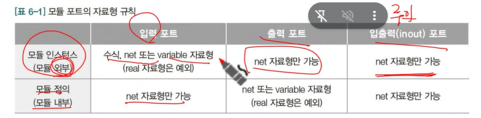
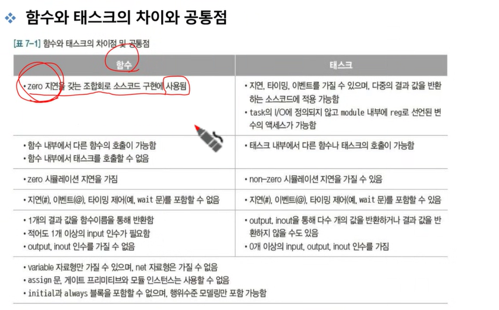
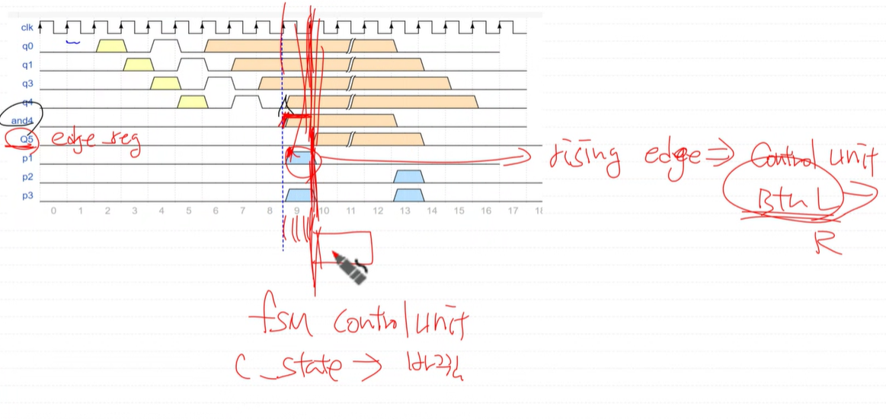

# 2026.10.12
파라미터

block문
- begin-end : 절차형 할당문 블록
- fork-join : 병렬문 블록

module
- 구조적 모델링 (structual modeling)
    하위모듈의 인스턴스와 포트 연결을 통한 모델링, 이름 생략 불가
- 포트 선언 (input,output,inout) input은 reg불가능, output은 reg,wire가능, inout은 wire만
    
- 모듈 파라미터

- 모듈 포트 연결 (순서 or 이름)

- defparam문
     상위는 못바꿈 , 하위는 바꿀수있음
     복수의 defparam 문이있으면 맨 마지막 꺼 적용

- 모듈 인스턴스의 파라미터 값 변경

생성문(generate statement)
- generate - endgenerate
    generate - for 
        gray to binary 변환기 모델링 - 숫자가 한개씩만 바뀜 따라서 이걸로 테스트 해보면 1개씩만 바뀌니까 어디서 문제났는지 알겠지요~
    , generate - if , generate - case

    initial,always블록 등의 인스턴스를 하나 또는 다수 개 생성
    모듈을 gemerate하는게 아니라 모듈 안에서 하는거임
    genvar
- 포트정의, 파라미터 정의 이런건 안된다.

genvar 선언
- genvar로 선언되는 변수는 정수형
- elaboration 과정: 시뮬레이션이나 합성을 위해 모듈을 분석하는 과정

계층적 이름(hierarchial name)
- 상향이름 참조 : 
- 

함수와 task

- 함수: 반드시 리턴 있음,시간 성분 없음, task 불러올 수 없음, task: 시간성분 있음, 함수 불러올 수 있음 (verilog에서는 task 자주 사용, system verilog에서는 함수도 많이 사용)
- input : 함수-input parameter , task- input port

" `define ","`timescale", "`include" - 경로 사용 주의, "`ifdef", "`else"
- ;붙이지 않는다. ` 로 시작되며 다은 컴파일러 지시어에 의해 대체되거나 또는 컴파일이 완료되기까지 전체소스 파일에 영향을 미친다.
- `define, `undefine
-
시스템 태스크와 시스템 함수
- $display,$write,$strobe, $monitor ...
- $fdisplay,$fgetc,$fgets, $readmemb,$sformat, $fscanf,$fread...
- $finish,$stop
- $realtime,$time,$stime
- $bitstoreal,$rigned...
- $random...
- $clog2,$ln...
- $readmemb,$readmemh...

# 면접 단골 질문
- $display,$strobe 차이.

latch 의도 할수도 있지만 의도하지 않은 latch는 절대 잇으면 안된다.
-default,else,초깃값 설정 으로 없애야한다.

옵티마이즈에서 중요한것은
메모리 사용량 줄이고,

noise 줄일려면?
(메케닉적인 노이즈가 없는건 정전식 터치)
-> syncronizer
=> debouncer(설계할때 얘가 곧 syncronizer)

4bit shift register
SIPO(serial in perrallel data)

p1 에서 상승엣지가 발생하고 나서 다음클럭에 c_state바뀐다.