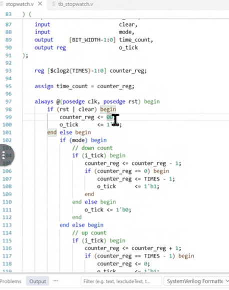

# 2026.10.14

프로젝트
- led 2개에 각각 시계인지, 스탑워치인지
- 스탑워치에 시간분 / 초 밀리초 이거 led
- 
기능 검증 /시간 분석 / 카운트

버튼디바운스 시뮬레이션 

fnd msec~ 이거끼리 넘어가는거 설명
도트 거짐 켜짐 설명, 

watch, stop워치 각각 기능 검증
주파수 엄청 올려버리는거 하지마라

대본 보지 마라! 

누구인지, 목적이무엇인지