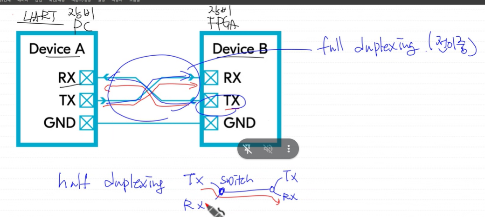

# 2026.10.15

면접

UART(Univertial Asyncronous Receive/Transmit) interface
USART syncronus +UART

serial 
- 1 line 통신 가능. tx/rx 로직 복잡. 속도 느림(UART가 느린거임),제어, 장거리 통신 유리
- (ex)8bit data -> _ _ _ _ _ _ _ _ 1bit 짜리 8개 로 전손 -> 다시 8bit 로 묶기
- UART(RS232),SPI,I^2C,USB

parallel
- multibit 통신.(line 많음) 속도 빠름/ skew , crosstalk(noise)-wire간의 간섭,tx/rx 로직 단순,주로 단거리
- pc의 main memory , bus, 피어 투 피어

- 비동기식(clk에 동기되지 않는다,clk line없음)
- 동기식 (clk에 동기된다.(edge,level), clk line있음)

full duplexing(전이중)
half duplexing
simple duplexing

UART protocal(규약/규칙/약속)
- LSB FIRST
- 1 ->0 시작 감지
- BAUD TIME => rate 1bit ,,,, 2400bps,,,9600bps,,,,19200bps,,,115200bp

pc<->fpga 통신기능 규칙
통신속도: 9600bps
databit: 8bit(ascii통신 목적)
stopbit: 1
pb: none
baudrate(보레잇): 초당 bit rate, start~stop bit(초당 몇비트 보내는지.) tx,rx 같아야함
pb(parity bit)오류검출 비트( 요즘은 잘 안씀)
 - even(짝수) / odd(홀수) : 1의 갯수 홀/짝으로 맞추어준다.단점: 1bit가 깨진건 잘 알지만 2, 4, 6, .. 비트가 깨져버리면 의미가 없음 

ASM(Algorithm state machine): fsm 디자인 방법중 한개.